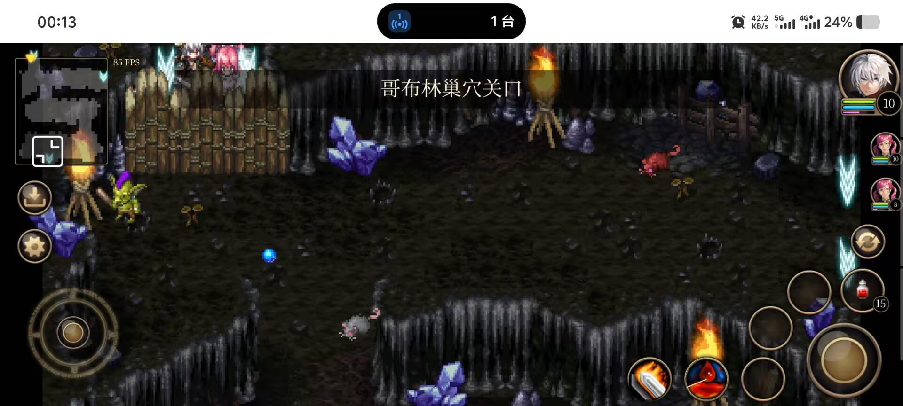

# 「哥布林巢穴1」左上角：人卡在门与地图出口之间（诊断记录）

这是一份只做诊断、没有改游戏代码的记录。结论、证据、复现命令和尚未确定的部分都在这里，接手的人（或 agent）可以照着直接查下去。

> 2026-10-31 补充：已核查原版行为与 24 像素保护的来源，见后文「补充核查（2026-10-31）」。当前 `src/`、`public/content/` 没有改动。



## 一句话结论

玩家站在 `goblin-s-lair-1-2fddb530`（哥布林巢穴1）左上角一个 4 格宽、可用高度只有 40px 的口袋里：南边是 4 扇「哥布林巢穴关口」木栅栏门（碰撞盒 `y 48..80`），北边是 4 个地图出口（`y 0..16`）。出口有一层“刚进图先别触发”的 24px 保护，把它盖住的正好是整个口袋；**能解除保护的那条线（脚点 `y = 40`）和关闭的门面完全重合**。所以人站在口袋中间往上走，出口毫无反应；必须先往南顶到门、再往北走，才会被送回哥布林监狱2。

## 现场怎么认出来的

| 线索 | 读数 | 结论 |
|---|---|---|
| 顶部黑色横条 | 「哥布林巢穴关口」 | 这是**交互目标名**，不是地图名。`NameBanner` 有两种模式：进图播地图名 2 秒，附近有交互对象时一直显示对象名（`src/rendering/name-banner.ts:59-72`，调用点 `src/scenes/world-scene.ts:1702`）。全内容里只有两个 gateway actor 叫这个名字（`public/content/world.json` 的 `actors.goblin-s-lair-gateway-150` 与 `actors.story-goblin-s-lair-gateway-37bddba6`）。这张地图的 `name` 是「哥布林巢穴1」。 |
| 小地图面板 | 外框 196x226 物理像素，地图 30 列 35 行，格宽 4 → `extent()` = 126x147 | 两轴比例 1.556 / 1.537 一致（缩放 1.545），对应 `goblin-s-lair-1-2fddb530`（480x560，30x35 格，tileSize 16）。 |
| 小地图青色 V | 右上、左下各一个 | 右侧出口组（`x=464, y=80..128`）与底边出口组（`x=144..192, y=544`）。截图里被白框圈住的是底边那个，通往 `hakan-desert-4`。 |
| 小地图黄三角 | 压在面板左上角 | 玩家在地图西北角，`minimapPoint(88,24)` = 格 (5,1)，图标中心确实会探出面板上边框。 |
| 那排木栅栏 | 精灵图不是地面贴图 | 是 4 扇 gateway actor 摆出来的（35x66 的图，`originX 0.714 / originY 0.894`，`public/assets/characters/goblin-s-lair-gateway-150/idle-south-normal.png`）。 |

## 几何：所有数字

| 东西 | 值 | 出处 |
|---|---|---|
| 顶部 4 个出口 | `(64,0) (80,0) (96,0) (112,0)`，各 16x16 | `public/content/maps/goblin-s-lair-1-2fddb530.json` |
| 出口通往 | `goblin-prison-2-27ab25e1`，对方落点 `(344,568)` | 同上 |
| 门 4 扇 | `x = 72 / 104 / 120 / 136`，`y = 72` | `public/content/campaign.json` 的 `event-23`、`event-24` 与 `placements` |
| 门碰撞盒 | `{x:-24, y:-24, width:32, height:32}` → 世界 `x 48..144`、`y 48..80` | `world.json` 的 `actors.goblin-s-lair-gateway-150` |
| 玩家碰撞盒 | `{x:-8, y:-8, width:16, height:16}`（脚点 = 盒底中点） | `world.json` 的 `actors.kiyan` |
| 到达保护距离 | 24（`EXIT_REARM_DISTANCE`） | `src/domain/navigation.ts:64` |
| 从监狱2 进图落点 | `(88,24)` | 监狱2 的出口定义 |
| 从仓库进图落点 | `(104,24)` | 仓库的出口定义 |

三条互相咬死的算式：

```
出口底边 16 + 保护距离 24 = 40      → 脚点 y < 40 都算“刚进图”，出口被锁
门碰撞盒上沿 48 - 玩家半高 8 = 40   → 顶到门时脚点正好是 40
40 = 40                            → 解锁线落在门面上，只差 0 像素
```

口袋的横向也出不去：墙在 `x=64` 和 `x=128`，可走 `x 68..124`；而出口的横向保护范围是 `40..152`。所以横向永远在保护里，**纵向的 `y = 40` 是唯一的解锁位置**。

## 代码路径

```ts
// src/domain/navigation.ts:64-72
export const EXIT_REARM_DISTANCE = 24;
export function nearExit(point: Point, exit: GameRectangle, distance = EXIT_REARM_DISTANCE): boolean {
  return point.x > exit.x - distance && point.x < exit.x + exit.width + distance
    && point.y > exit.y - distance && point.y < exit.y + exit.height + distance;
}
```

```ts
// src/domain/navigation.ts:79-98（只留 guarded 分支）
constructor(exits: T[], spawn: Point, arrivalGuard = true) {
  this.blocked = new Set(arrivalGuard ? exits.filter(exit => nearExit(spawn, exit)) : []);
}
update(position: Point, moving: boolean, available: (exit:T)=>boolean = ()=>true): T | null {
  for (const exit of this.blocked) if (!nearExit(position, exit)) this.blocked.delete(exit);
  const exit = this.exits.find(exit => !this.blocked.has(exit) && available(exit) && overlapsFootRect(position, exit));
  if (!exit || !moving) return null;
  for (const other of this.exits) if (nearExit(position, other)) this.blocked.add(other);
  return exit;
}
```

- 进图时用落点建一次锁：`src/scenes/world-scene.ts:443-446`。那里的注释写着设计意图：“落点可以正压在回程出口上；出口在玩家走出到达缓冲区前保持锁定，走回来才触发。”
- 每帧在 `afterMovement` 里判定：`src/scenes/world-scene.ts:1844`。
- 贴边接触用 `overlapsFootRect`（半高 8，`src/domain/navigation.ts:55`）→ 脚点 `y < 24` 才算压住出口，所以落点 `y = 24` 恰好不算压住，人也不会被立刻弹走。
- 出口是否可用与剧情无关：`campaign.exitRules` 是空数组，全内容没有 `"type":"exit"` 的命令，`story-world.ts:103` 默认全部可用。这张图的出口一定“开着”。

## 复现

### 1) 探针脚本（不需要浏览器、不需要真机）

`tmp-exit-probe.ts`（仓库根目录，**未提交**）用真的 Arcade 物理（`World`/`Body` + `movementBodyClass`，和 `tests/movement.test.ts` 同一套做法）加载真实地图和真碰撞盒，门按内容坐标摆成不可移动体，玩家放在真实落点。

```bash
node tmp-exit-probe.ts
```

关键输出（速度取真实值 `8*1000/60 = 133.33 px/s`）：

```
上(3s) → 下(3s) → 上(3s)   → (88.0,4.0) guard=3 → (88.0,40.0) guard=0 → 触发 goblin-prison-2-27ab25e1 @(88.00,22.22)
下(3s) → 上(3s)            → (88.0,40.0) guard=0 → 触发 goblin-prison-2-27ab25e1 @(88.00,22.22)
只按向下                    → 终点 (88.00, 40.00)  离开缓冲=true  触发=无
只按向上                    → 终点 (88.00,  4.00)  离开缓冲=false 仍在缓冲内出口数=3  触发=无
只按向左 / 只按向右          → 终点 y 保持 24      离开缓冲=false
没有门时只按向下             → 一路走到 (88.00, 170.67)
```

“guard” = 仍被锁住的出口数。上表说明：**人在出口格里按上什么都不会发生；只有顶到门（脚点 40.00，Phaser 分离不留 epsilon）才会解锁**。

### 2) 游戏里手复现

GM 打开时（`globalThis.gm` 存在）：

```js
gm.travel('goblin-s-lair-1-2fddb530', { x: 88, y: 24 })
```

然后：按住“上”→ 人停在出口格里、没有任何反应；按住“下”→ 顶到木栅栏、屏幕出现「哥布林巢穴关口」；再按住“上”→ 立刻被送回哥布林监狱2。

## 玩家是从哪儿掉进这个口袋的

这张图有 4 个入口，其中两个直接把人送进保护带（`y = 24`）：

| 入口地图 | 出口位置 | 传过来的落点 |
|---|---|---|
| `goblin-prison-2-27ab25e1` | `(320..352, 576)` | `(88,24)` ← 口袋正中 |
| `goblin-s-storage-b89e5292` | `(112..160, 496)` | `(104,24)` ← 口袋正中 |
| `hakan-desert-4-7c711a9e` | `(432..448, 64)` | `(168,536)`（地图底部，正常） |
| `goblin-s-lair-2-86774f0b` | `(0, 112..160)` | `(472,120)`（地图右侧，正常） |

也就是说，从监狱或仓库走回巢穴1，**必定**落在被锁的出口和关闭的门之间。

## 门为什么一直关着

- `event-23` 的 cast 先把 4 扇门和哥布林警卫摆成 `visible:false`，随后 `commands` 里的 `world/place` 把 `story-object-23-40/41/42`、`quest-npc-located-npc-98/150/151` 设成 `visible:true`。
- `event-24` 再补两扇（`story-object-24-6/7`、`quest-npc-located-npc-152/153`）。
- `campaign.placements` 里还有一条 `quest-npc-located-npc-150`（条件 `flag quest-npc-located-npc-150`）也摆一扇。
- 合起来就是 `x = 72 / 104 / 120 / 136`、`y = 72` 的四扇，碰撞盒连成 `x 48..144`、`y 48..80`，把顶部 4 格通道的南口封死。
- 全内容里**没有任何命令把这些门隐藏或移除**，所以这个口袋是永久的。

## 已经排除的可能

| 猜测 | 为什么不是 |
|---|---|
| 出口被剧情关掉了 | `campaign.exitRules` 是 `[]`；全内容没有 `"type":"exit"` 命令；`story-world.ts:103` 默认可用。 |
| 横条是地图名 | 地图名是「哥布林巢穴1」；「哥布林巢穴关口」只出现在两个 gateway actor 的 `name` 上。 |
| 栅栏是地面贴图 | `goblin-s-lair-1` 的 `ground.png` 上没有任何栅栏；栅栏来自 actor 精灵。 |
| 掉帧让 3px 步长的地形约束把人卡住 | 用 120ms / 60ms 帧步实测都停在 `y = 40.00` 并解锁；真实速度下 Arcade 分离会补到 40。 |
| 队友挡在门口 | 伙伴在主世界根本不生成（`party-ai.ts` 没有被任何地方 `new`）；而且 `blocksActor`（`src/domain/navigation-world.ts:28`）只在**双方都是 `party`** 时才不碰撞，而 `world-scene.ts:831` 只把 `entity.id === 'player'` 注册成 `party`。反过来说，**任何 neutral 的实体都会挡人**。 |

## 还没确定的部分

1. **截图里玩家的确切 y。** 条幅出现要求玩家与门相邻（`nearInteractive` 的 `bodyGap ≤ 8`，即脚点 `y ≥ 32`，见 `src/domain/chests.ts`），而小地图箭头又偏向第 0~1 行。像素分辨率不足以区分 `y = 32..39`（仍在保护里、出口是死的）和 `y = 40`（已经解锁、按上会弹回监狱）。两种都在同一个口袋内，不影响上面任何结论。
2. **玩家当次的具体操作顺序。** 决定他看到的是“按上没反应”还是“往下走回去被判回监狱”。截图只能证明他在门口。

## 如果之后要修（本次按用户要求没动）

几个方向，代价和影响面不一样：

1. **让保护只朝出口方向生效**，或**只在还压着出口时生效**——现在它完全不看移动方向，人朝外走也拦。改 `src/domain/navigation.ts` 的 `ExitTrigger.update`，影响所有地图。
2. **小房间自适应**：保护距离取 `min(24, 到最近阻挡的距离)`，或给保护加时间上限（例如 1.5 秒后自动解除）。同样改 `navigation.ts`，影响所有地图。
3. **改落点**：把监狱2 / 仓库的出口落点移到 `y ≥ 40`（或门外、房间内），或把 4 扇门挪到更南边，让口袋高度大于保护带。只改内容 JSON，影响面最小。
4. **让门可穿过或剧情后撤掉门**：改内容 + 剧情，属于设计改动。

## 补充核查（2026-10-31）：原版怎么做、为什么会退化成这样

> 这一节是后续核查，不改变上面已有的诊断。游戏代码没有改；仓库里仍只有文档、截图和探针。

### 1. 原版没有「出口门禁」这层数据

原版分析在仓库外：`/Users/wangjr/Desktop/workspace/inoita`。关键结论来自 `work/findings/99_map_gating_2026-10-15.md`：

- 出口记录 6 字节被所在格、目标格、目标图号、进入方向、离开方向占满，没有条件位。
- 78 个事件命令里没有解锁/封锁出口的命令；`MAPINFOBASE` 没有准入字段。
- 门/路障是普通阻挡实体，由带任务条件的事件用 `0x18/0x25/0x28` 移除。
- 复刻的 `exitRules` 是复刻自己的机制；给这些出口加规则 = 新增原版没有的行为。

所以「关门时把监狱2/仓库到巢穴1的 7 个回程出口关掉」不是原版做法，至少不能当成原版修复。

### 2. 原版出口触发看方向，不看距离

`work/findings/46_story_navigation.md`：

> `MAP_FindMapLink` 按记录前两字节匹配所在格子，并检查方向；……最高三位是离开方向，值 4 表示不限方向。

复刻导出了 `exitFacing`（`src/domain/content.ts:166`），但运行期没读：`ExitTrigger` 只看「在移动 + 脚底碰到出口格」，`changeMap` 只用 `exit.facing` 作为到达朝向（`src/scenes/world-scene.ts:1220`）。

巢穴1 顶部 4 个出口的 `exitFacing` 是 `north`。玩家在 `(88,24)` 按上，移动方向 north 匹配，按原版应立刻触发。

### 3. 24px 是复刻补丁，不是原版

- `9c74a0e` 的提交说明：「落点经常离回程出口只有一两像素，走一步就会弹回上一张图」。
- 同一提交加了 `entryInputGate`（切图后方向必须回中）和 `EXIT_REARM_DISTANCE = 24`。
- 因为复刻没有方向判定，任何方向的移动都算触发，所以要用距离来猜「玩家是不是已经走开」。
- 24px 是绝对距离，和地图可走空间无关；巢穴1 口袋只有 16px 垂直空间，解锁线正好落在门面上。

### 4. 关键数值（巢穴1）

| 项 | 值 |
|---|---|
| 落点 | `(88,24)` |
| 顶部出口 | `y 0..16`，`exitFacing: north` |
| 脚底矩形 | `y-8..y+8`；`y < 24` 才压住出口 |
| 按上最远 | `y = 4`（地图顶边），从落点实际移动 20px |
| 门碰撞盒上沿 | `y = 48`；脚点最多到 `y = 40` |
| 24px 解锁线 | `y = 40` |
| 口袋可走范围 | `y 4..40`，共 36px |

### 5. 门与 7 个回程出口（决定内容门禁要不要做）

- `event-23`（沙漠区域触发）放置 3 扇门（`x 72/104/136, y72`）；`quest-27` 说关口被锁，钥匙在监狱2/仓库；`event-24`（`quest-27` 完成后）把玩家送到门内的 `(152,232)`，重新摆 2 扇门（`x 72/120`），并置位 `quest-npc-located-npc-152`；`quest-28` 说关口已关闭，去找别的入口。
- 进巢穴1 门外的 7 个回程出口：
  - `goblin-prison-2-27ab25e1`：`(320/336/352, 576)` → `(88,24)`
  - `goblin-s-storage-b89e5292`：`(112/128/144/160, 496)` → `(104,24)`
- 原版没有出口门禁，这 7 个出口在原版也开着。玩家可以绕到门外，门挡住入口，玩家再按上回监狱。要不要在复刻里关掉它们，是产品取舍，不是原版修复。
- `quest-npc-located-npc-152` 是 `event-24` 置位、之后不再置 false 的标记；如果以后确实要加内容门禁，可以用它作为「门已关」条件，老档也生效。

### 6. 「总移动距离 24px 后解锁」提案的核查

提案：不再看脚点离出口多远，而是累计进图后的实际移动距离；累计 ≥24px 后允许出口触发。

实测/推演：

- 从落点按上只累计 20px（`y24→y4`），到不了 24；继续按上被顶边挡住，累计不变。
- 若此时转身向下，走到 `y=8` 时累计到 24；人仍在出口格内（脚底 `y0..16`），且正在向下移动。若解锁和触发在同一帧判定，出口会立刻触发，把玩家送回监狱。
- 若先向下走到门口（16px），再向上走 8px，累计 24 时人已在出口格外（`y=32`），解锁成立；继续向上到 `y<24` 才触发。也就是说，解锁点比现在早 8px（`y=32` vs `y=40`），但触发仍要走到 `y<24`，玩家还是得先下后上，没有减少绕路。
- 所以这个方案能不能用，取决于解锁那一帧是否暂停触发、是否要求玩家已离开出口格、以及累计的是实际位移还是输入意图。作为「按上直接走」的修复，它没有解决 `20px < 24px` 的缺口；作为「提前解锁」的改进，它只把解锁点提前了 8px，触发点没变，仍不是原版语义。
- 如果提案的本意是「解锁后仍要求从出口格外重新进入」，那就等价于「离开出口格」的 latch，距离只影响解锁时机；请下一位实现者先确认提案的精确语义。

> 用户认为正常玩家不会在出口徘徊；上面的关键不是徘徊，而是按上只能累计 20px，以及转身向下时会在出口格内凑满 24。这个分歧留给下一位实现者用探针/试玩复核。

### 7. 可选修复方向

**A. 按原版补方向匹配（保真）**

- `ExitTrigger` 增加移动方向参数；出口带 `exitFacing` 时要求方向匹配（`any` 不限）。
- 删除 `EXIT_REARM_DISTANCE` / `nearExit`。
- 保留 `entryInputGate`。
- 出生点压在出口格上时，保留「脚底离开出口格后再回来」的 latch（不是距离）。
- 无头剧情辅助器（`arrivalGuard=false`）保持旧语义，避免剧情回放受影响。
- 内容零改动。
- 先做全量 `exitFacing` 数据审计和巢穴1 红用例。

**B. 最小改动：把 24px 换成「离开出口格」**

- 到达时脚底压住的出口格先锁住；脚底离开这些格后解锁；触发后重新锁住脚下门洞。
- 巢穴1 落点本来就没压住出口，按上直接触发。
- 这条比 A 小，但不是原版的方向判定；它对应的是「出生保护」而不是「出口方向」。

**C. 内容门禁（有意偏离原版）**

- 在 `event-24` 关门时，用 `exitRules` 或 `world/exit` 关闭监狱2/仓库到巢穴1 的 7 个回程出口；条件可用 `quest-npc-located-npc-152`。
- 按 findings 99，这是新增原版没有的规则，应记录为有意偏离。
- 它只能阻止玩家再绕到门外，不能修 `event-24` 之前玩家在门外找钥匙的合法状态；已卡在门外的老档仍需要 A 或 B 才能出来。

**D. 总移动距离 24px**

- 见第 6 节。按当前推演，单独使用不能修「按上没反应」，还可能在向下走时触发出口；若要采用，必须先定义「解锁那一帧是否暂停触发」和「是否要求已离开出口格」。

### 8. 建议的验证

1. 先跑数据审计：3073 个出口的 `exitFacing` 分布；缺失/`any` 的比例。
2. 写红用例：`new ExitTrigger(lair.exits, {x:88,y:24})`，`update({x:88,y:20}, true, undefined, 'north')` 返回北侧出口；当前实现返回 `null`。
3. 实现 A 或 B 后：
   - `npm test -- tests/session.test.ts tests/story-exit-gates.test.ts`
   - `npm run typecheck`
   - `node tmp-exit-probe.ts`（注意：探针现在导入 `nearExit`，改 API 后要同步更新，或者确认结论后直接删）
4. 游戏内验收：`gm.travel('goblin-s-lair-1-2fddb530', {x:88, y:24})`，按上应直接回监狱；按左/右/下不应误触。
5. 内容没改，不跑 `validate:content`；全量测试除非用户要求，不跑。

### 9. 当前状态

- `src/`、`public/content/` 没有改动。
- 未提交文件：本文档、`docs/images/goblin-lair-gateway-stuck.jpg`、`tmp-exit-probe.ts`。
- 顶部诊断的结论仍然成立；这一节只补充「原版怎么做」和「为什么会有 24px」。
- 上面第 6、7 节的分歧没有替用户做决定；下一位实现者应先确认目标（原版保真 / 最小修复 / 阻止绕后门）再动代码。

## 索引

| 位置 | 内容 |
|---|---|
| `src/domain/navigation.ts:55` | `overlapsFootRect`（半高 8） |
| `src/domain/navigation.ts:64-72` | `EXIT_REARM_DISTANCE`、`nearExit` |
| `src/domain/navigation.ts:79-99` | `ExitTrigger`（到达保护、解锁、触发后整簇加锁） |
| `src/domain/navigation-world.ts:28` | `blocksActor`（只有双方都 `party` 才不碰） |
| `src/scenes/world-scene.ts:443-446` | 进图落点 `nearestBody` + `new ExitTrigger(map.exits, spawn)` |
| `src/scenes/world-scene.ts:831` | `register(character, player, player, player ? 'party' : 'neutral')` |
| `src/scenes/world-scene.ts:1373` | `syncControlledCharacter(true)` 会用当前位置重建 `ExitTrigger`（在保护带里切人 = 重新上锁） |
| `src/scenes/world-scene.ts:1702` | 条幅文字取自交互目标 |
| `src/scenes/world-scene.ts:1844` | 每帧出口判定 |
| `src/rendering/name-banner.ts` | 条幅的两种模式 |
| `src/domain/chests.ts` | `nearInteractive` / `bodyGap` 的交互可达距离 |
| `public/content/maps/goblin-s-lair-1-2fddb530.json` | 出口、`blocked`（1050 个布尔，30 列 x 35 行）、torch / map-exit 实体 |
| `public/content/campaign.json` | `event-23`、`event-24` 的门，`placements.quest-npc-located-npc-150` |
| `public/content/world.json` | `actors.goblin-s-lair-gateway-150`、`actors.kiyan` 的碰撞盒 |
| `src/domain/content.ts:166` | `exitFacing` 字段；运行期未读取 |
| `/Users/wangjr/Desktop/workspace/inoita/work/findings/99_map_gating_2026-10-15.md` | 原版没有出口门禁/出口条件；`exitRules` 是复刻机制 |
| `/Users/wangjr/Desktop/workspace/inoita/work/findings/46_story_navigation.md` | 原版 `MAP_FindMapLink` 匹配出口格并检查离开方向 |

相关提交：`b9331cb`（进图不再挪动落点，改靠出口缓冲区防回跳，删掉了 `findExitFreeSpawn`）、`9c74a0e`（进图后必须先离开出口缓冲区才会再次触发）。

## 本次留下的文件

| 文件 | 说明 |
|---|---|
| `tmp-exit-probe.ts` | 未提交的探针，`node tmp-exit-probe.ts` 可重跑；现在导入 `nearExit`，改 `ExitTrigger` 签名后要同步更新，或确认结论后直接删。 |
| `docs/images/goblin-lair-gateway-stuck.jpg` | 报错截图（1920x864 手机截图）。 |

游戏代码没有任何改动：`git status` 里只有这份文档、截图和探针三样，都在 `src/` 之外。上面「补充核查（2026-10-31）」记录了原版行为、20px 实测、总移动距离提案的推演和 A/B/C/D 四个方向；下一位实现者先看那一节。
